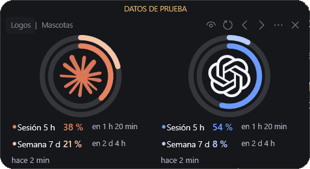
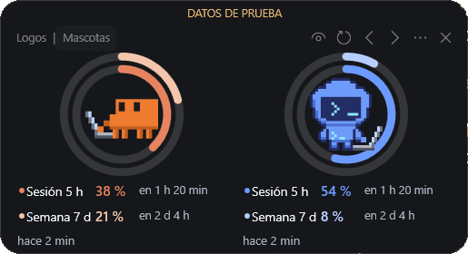

# Usage Orbit

[](https://github.com/LeobardoVillalobos88/widget-usage-orbit/actions/workflows/compilar.yml)

Widget de escritorio que muestra en anillos cuánto llevas consumido de tus límites de **Claude Code** y **Codex**: la sesión de 5 horas y la semana, con el porcentaje y el tiempo que falta para cada reinicio.

| Logotipos | Mascotas |
|---|---|
|  |  |

*Capturas con datos de prueba.*

- Elige entre **logotipos** o **mascotas en pixel art**. Las mascotas se quedan quietas en reposo y, cuando el asistente está trabajando, giran de lado, sacan su laptop y teclean.
- Muestra **ambos asistentes, solo Claude o solo Codex**.
- Vista **completa** o **solo imágenes**.
- Flota sobre las demás ventanas, se arrastra y se puede esconder en el borde izquierdo o derecho, dejando una pestaña para recuperarlo.
- Se abre solo tres minutos después de iniciar sesión en Windows.
- Ligero: sin servicios en segundo plano. La animación solo corre mientras una mascota trabaja; en reposo, el widget solo se despierta cada 30 segundos para actualizar los textos y cada 5 minutos para consultar el uso.

## Requisitos (Windows)

- Windows 10 u 11. El compilador de .NET Framework que usa el instalador ya viene con Windows.
- La CLI de cada asistente que quieras ver, con una suscripción que tenga límites de uso:
  - **Claude Code** (Claude Pro o Max): `npm install -g @anthropic-ai/claude-code`
  - **Codex** (ChatGPT Plus, Pro o similar): `npm install -g @openai/codex`

  Si te falta alguna, el instalador te ofrece instalarla. Para eso necesitas [Node.js](https://nodejs.org).

## Instalar

1. Descarga el repositorio: botón **Code → Download ZIP** y descomprímelo, o bien `git clone https://github.com/LeobardoVillalobos88/widget-usage-orbit.git`.
2. Haz doble clic en **`instalar.cmd`**.
3. Elige la apariencia (logotipos, mascotas o ambas con un selector para cambiar) y qué asistentes quieres ver. La vista (completa o solo imágenes) se cambia cuando quieras desde el widget.
4. Si alguna CLI no tiene una sesión iniciada, se abre el navegador para que entres con tu cuenta.

El widget se instala solo para tu usuario en `%LOCALAPPDATA%\UsageOrbit`, sin permisos de administrador, y crea accesos directos en el Escritorio y en el menú Inicio. Para cambiar de opciones o actualizar, vuelve a ejecutar `instalar.cmd`.

Si Windows muestra un aviso de seguridad al abrir `instalar.cmd` descargado de internet, es por venir de un ZIP: el instalador compila el widget en tu equipo a partir del código de este repositorio.

También se puede instalar sin preguntas:

```bat
instalar.cmd -Variante Mascotas -Asistentes Ambos
```

`-Variante` acepta `Logotipos`, `Mascotas` o `Ambas` (solo con `Ambas` se puede cambiar la apariencia desde el widget) y `-Asistentes` acepta `Ambos`, `Claude` o `Codex`.

## Uso

- **Arrastrar**: desde cualquier parte del panel.
- **Barra superior**: `Logos | Mascotas` (si instalaste con «Ambas»), cambiar vista, actualizar, esconder a la izquierda o a la derecha, más opciones y cerrar.
- **Clic derecho**: apariencia (si instalaste con «Ambas»), vista, asistentes, inicio con Windows, acerca de, desinstalar y cerrar.
- **Anillos**: el exterior es la semana y el interior la sesión.
- **Cerrar** termina el widget por completo; **esconder** lo deja como una pestaña en el borde.

## Desinstalar

Haz doble clic en **`desinstalar.cmd`**, o usa «Desinstalar Usage Orbit» en el menú Inicio o en el menú del widget. Se borran exclusivamente sus archivos, sus accesos directos y su inicio automático. Tus sesiones de Claude Code y Codex no se tocan.

## Mac (experimental)

En [`mac/`](mac/README.md) hay una versión para macOS. Es **experimental**: GitHub la compila en macOS con cada cambio, pero todavía no se ha probado su funcionamiento en un Mac. Si la pruebas, cuéntanos cómo te fue.

## Cómo obtiene los datos

- **Codex**: consulta los límites con el `app-server` oficial de la CLI (`account/rateLimits/read`). No crea conversaciones ni gasta uso.
- **Claude Code**: usa el mismo servicio que la CLI muestra con `/usage`. **No está documentado públicamente**, así que podría cambiar; en ese caso solo hay que ajustar [`ClaudeUsageSource.cs`](windows/Data/ClaudeUsageSource.cs). Lee el token de sesión que la CLI guarda en tu equipo y lo envía únicamente a `api.anthropic.com`. Cuando el token caduca, ejecuta `claude plugin list`, que lo renueva sin hacer inferencias.
- **Animación**: para saber si un asistente está trabajando, solo observa cuándo cambian sus registros de sesión (`~/.claude/projects` y `~/.codex/sessions`). Nunca lee su contenido.
- No hay telemetría ni se envían datos a terceros.

Más detalles en [docs/como-funciona.md](docs/como-funciona.md).

## Autor

Creado por [LeobardoVilla88](https://github.com/LeobardoVilla88) y [LeobardoVillalobos88](https://github.com/LeobardoVillalobos88).

## Aviso

Proyecto personal, sin afiliación con Anthropic ni OpenAI. Claude, Claude Code, Codex, ChatGPT y sus logotipos son marcas de sus respectivos dueños. Los logotipos provienen de [Simple Icons](https://simpleicons.org) (CC0), y las mascotas son pixel art hecho para este widget.

## Licencia

[MIT](LICENSE)
